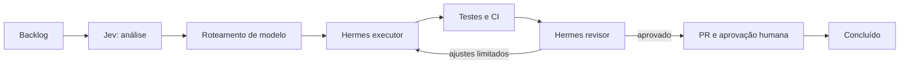

# Workflow da tarefa

1. Validar projeto, repo, branch base, critérios de aceite, permissão e budget.
2. Coletar **resumo factual sanitizado** de repo/arquivos, sem enviar segredos ao Jev.
3. Jev: `Choice` tipo de tarefa, `Score` complexidade/risco por rubrica e `Noul` avaliações binárias. A pontuação 0–100 é **normalização interna versionada**, não necessariamente saída nativa.
4. Roteador filtra modelos OpenRouter por allowlist, contexto, tools, custo, disponibilidade e política de dados; grava candidatos/razão.
5. Preparar sandbox, branch e token efêmero; Hermes recebe `provider` e `model` por request após checagem de capabilities.
6. Capturar stream, registrar `run_id` e `runtime` real, custo, arquivos e artefatos; aplicar timeout e hard budgets.
7. Executar testes/lint/build autorizados; revisor independente retorna `pass|changes_requested|blocked` com achados e evidências.
8. Rejeição volta ao executor até limite; sucesso abre PR; aguarda CI do SHA real e humano antes de merge.
9. Finalizar auditoria/uso e remover sandbox.

Separar estados: task (backlog/analysis/ready/development/validation/approval/done/blocked), run (queued/running/reviewing/completed/failed/cancelled), PR (draft/open/approved/merged/closed). Replays, retries e GitHub webhooks idempotentes. Ação sensível ou falta de confiança deve falhar fechado.
