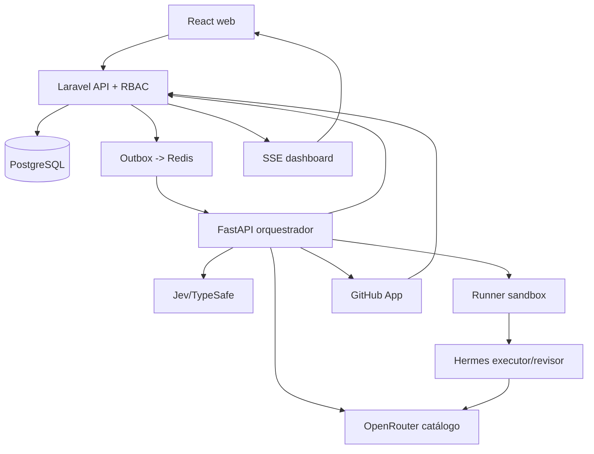

# Arquitetura

## Ownership
- Laravel: API pública, auth, autorização, projetos, boards, tasks, estados canônicos, audit log, aprovação.
- FastAPI: fila/eventos, análise, roteamento, orçamento, lifecycle e adaptadores com contratos internos autenticados.
- Runner: workspace/worktree/container por run, execução de comandos autorizados, logs e teardown.
- PostgreSQL: fonte de verdade; Redis: filas/cache. Artefatos em storage protegido com TTL.
- React: apenas navegação/interação; não acessa provedores diretamente.

## Pipeline
Transação Laravel cria run + outbox; consumer idempotente analisa, escolhe modelo, reserva orçamento, prepara sandbox; Hermes recebe provedor `openrouter` e modelo escolhido, executa; testes + revisor separado; PR GitHub; CI + humano liberam conclusão. Registrar pedido/real e uso. Integrar Hermes com `/v1/capabilities` antes de assumir endpoints e usar `Idempotency-Key` se disponível.

## Sincronização
**Não criar duas fontes de verdade**: Kanban da plataforma no PostgreSQL. Kanban nativo Hermes (quando usado) é detalhe interno sincronizado por adapter, não outro quadro independente editável.

## Concurrency
Bloqueio por run e branch, worktree isolado por tarefa, `task.version` optimistic lock, processamento único por `event_id`, backoff e DLQ.

## Segurança de rede
API do Hermes privada com chave por perfil; sem acesso direto do browser. Executors nunca têm Docker socket, root, rede host, credenciais de produção nem disco de outro tenant.
